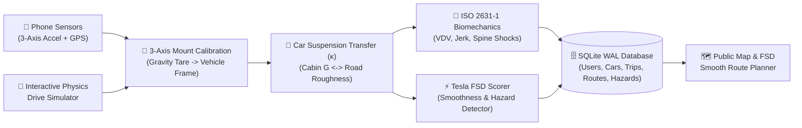

# SmoothRoute ⚡🛣️🦴

**End-to-End Car & Phone G-Force Telemetry Tracker, Biomechanical Body-Wear Analyzer, and Tesla FSD Smooth Route Planner**

[](LICENSE)
[](https://nodejs.org)
[](#tesla-fsd-smooth-route-planner)

**SmoothRoute** is an open-source full-stack web & mobile Progressive Web App (PWA) that allows drivers to:
1. **Sign up & create an account** with their specific **car, RV, or truck suspension profile** (Tesla Model 3 Highland, Model Y, Model S Air, Model X, Cybertruck, Rivian R1S, BMW i4, Toyota Prius, Porsche 911, Mercedes-Benz Sprinter Camper Van, Class A/C Motorhomes, Ford F-250 Fifth-Wheel Tow Rig, Lexus/Mercedes Spine-Saver Sedan, or custom vehicles).
2. **Track real-time 3-axis G-forces with their phone** (`DeviceMotionEvent` accelerometer + `Geolocation` GPS + 3-axis phone mount angle zeroing) as they travel.
3. **Normalize G-forces based on their car's suspension & tire sidewall** (and convert bidirectionally with **USDOT FHWA HPMS International Roughness Index — IRI in `in/mi`**) so the public map accurately reflects true road roughness while predicting exact cabin G-loads for any driver's specific car.
4. **Quantify cumulative human body wear** using **ISO 2631-1 Whole-Body Vibration (WBV)**, **4th-Power Vibration Dose Value ($\text{VDV}$)**, **3D Jerk ($\text{G/s}$)**, and **Spinal Compression Micro-Shocks**.
5. **Optimize routes for Tesla Full Self-Driving (FSD) & driver comfort**, helping drivers avoid high-G potholes, sunken bridge expansion joints, concrete slab harmonic bounce, and abrupt FSD deceleration zones in favor of ultra-smooth corridors.

---

## Why SmoothRoute?

Standard navigation apps optimize strictly for **shortest travel time**, frequently routing drivers onto freight-rutted highways or broken urban pavement to save 90 seconds—at the cost of **3x–5x higher vertical G-shocks** on the human spine and vehicle suspension.

In biomechanics (**ISO 2631-1**), cumulative spinal disc and joint wear scales with the **fourth power** of acceleration ($\text{VDV} = (\int a_w^4 \, dt)^{1/4}$). A single $0.80\text{ G}$ pothole impact inflicts **$16\times$ more mechanical shock** on the human body than a $0.40\text{ G}$ road ripple. And for **Tesla FSD (Supervised)** drivers, smooth pavement with predictable curvature and zero sunken expansion joints is the single biggest factor in a serene, zero-intervention autonomous drive.

---

## Core Architecture & Physics Engine



### 1. 3-Axis Phone Mount Calibration (`calibrateMountOrientation`)
Whether your phone rests on a Tesla angled wireless charging pad (~62°), a MagSafe center-screen mount (~75°), or a dash cradle, SmoothRoute measures the stationary gravity vector $\vec{g}_{\text{base}} = (g_x, g_y, g_z)$ and constructs an orthonormal vehicle coordinate basis $(\hat{e}_{\text{lon}}, \hat{e}_{\text{lat}}, \hat{e}_{\text{vert}})$ via Gram-Schmidt orthogonalization:
- **Vertical Dynamic G ($G_{\text{vert}}$)**: Potholes, bridge joints, speed humps, vertical jounce/rebound.
- **Longitudinal G ($G_{\text{lon}}$)**: Acceleration ($+$) and braking / FSD deceleration ($-$).
- **Lateral G ($G_{\text{lat}}$)**: Cornering and lane-change side loads.

### 2. Car Suspension Transfer Normalization (`computeVehicleTransferFactor`)
A road bump that registers $0.39\text{ G}$ inside a **Tesla Model S with Adaptive Air Suspension** ($\kappa = 0.78\times$) can register $0.62\text{ G}$ inside a **Tesla Model 3 Performance on 20" 30-series tires** ($\kappa = 1.24\times$). SmoothRoute:
- Divides recorded vertical G-forces by the recording vehicle's damping factor $\kappa_{\text{car}}$ to compute a **vehicle-independent Normalized Road Roughness Index**.
- Multiplies any public route's baseline roughness by **your selected car's $\kappa_{\text{car}}$** so you see the exact Peak G, RMS G, and Body Wear Score you will experience in your car.

### 3. Tesla FSD Smooth Route Planner (`rankRoutesForDriver`)
Compare candidate routes across four selectable routing modes:
- **⚡ Tesla FSD Smooth Priority (`fsd_smooth`)**: Maximizes FSD Comfort Score (0–100) by penalizing potholes, abrupt braking merges, and high jerk.
- **🦴 Spine & Body Protection (`low_body_wear`)**: Minimizes ISO 2631-1 Vibration Dose Value ($\text{VDV}$) and spinal compression micro-shocks ($|G_{\text{vert}}| \ge 0.30\text{ G}$).
- **⚖️ Balanced (`balanced`)**: Balances road smoothness, body wear, and travel time.
- **⏱️ Fastest Raw ETA (`fastest`)**: Ranks by raw duration while surfacing high-G hazard warnings.

---

## Quickstart

### 1. Clone & Install
```bash
git clone https://github.com/goffythebird/smoothroute.git
cd smoothroute
npm install
```

### 2. Configure Private Credentials (`.env`)
Copy `.env.example` to `.env` and generate your private cryptographic secrets (never committed to git):
```bash
cp .env.example .env
chmod 600 .env
node -e '
const crypto = require("crypto");
const fs = require("fs");
let env = fs.readFileSync(".env", "utf8");
env = env.replace("replace_with_64_byte_random_hex_secret_do_not_commit", crypto.randomBytes(48).toString("hex"));
env = env.replace("replace_with_64_byte_random_hex_cookie_secret", crypto.randomBytes(48).toString("hex"));
env = env.replace("replace_with_32_byte_random_hex_telemetry_signing_key", crypto.randomBytes(32).toString("hex"));
env = env.replace("replace_with_private_admin_api_key", "sr_live_" + crypto.randomBytes(24).toString("hex"));
fs.writeFileSync(".env", env, { mode: 0o600 });
'
```

### 3. Seed Database & Start Server
```bash
npm run seed
npm start
```
Open **`http://localhost:3847`** on your phone or desktop browser.

### 4. Run Automated Tests & Secret Audit
```bash
npm test
npm run audit:secrets
```

---

## REST API Overview

| Method | Endpoint | Description |
| :--- | :--- | :--- |
| `GET` | `/api/health` | Service health check & live database statistics |
| `POST` | `/api/auth/signup` | Register a new driver account + primary car profile |
| `POST` | `/api/auth/login` | Authenticate with username/email & password (returns JWT) |
| `GET` | `/api/auth/me` | Retrieve current driver profile, mount calibration & garage |
| `PUT` | `/api/auth/profile` | Update driver FSD/smoothness preferences & mount calibration |
| `GET` | `/api/vehicles/templates` | List pre-calibrated vehicle suspension templates |
| `GET` | `/api/vehicles` | List authenticated driver's garage vehicles |
| `POST` | `/api/vehicles` | Add a vehicle to garage with suspension & tire calibration |
| `PUT` | `/api/vehicles/:id/primary` | Set active primary vehicle for G-force route predictions |
| `POST` | `/api/trips/calibrate` | Calibrate 3-axis phone mount orientation from gravity vector |
| `POST` | `/api/trips` | Save recorded G-force trip, compute VDV/FSD scores & map hazards |
| `GET` | `/api/trips` | List public community trips or personal trip history |
| `GET` | `/api/trips/:id/export` | Export trip telemetry in `csv`, `gpx`, or `json` format |
| `GET` | `/api/routes` | List public routes scored for active vehicle & routing mode |
| `GET` | `/api/routes/us-hpms-baselines` | Nationwide USDOT FHWA HPMS (IRI `in/mi`) & OSM baseline corridors |
| `POST` | `/api/routes/compare` | Compare corridor routes for Tesla FSD & body wear reduction |
| `POST` | `/api/routes/custom-plan` | Plan & score any real-world US origin/destination via OSRM + HPMS IRI |
| `GET` | `/api/hazards` | List GPS-pinned high-G road hazards (potholes, joints, brakes) |
| `POST` | `/api/hazards` | Report a new high-G road hazard to the public map |
| `GET` | `/api/analytics/summary` | Platform totals, top smooth routes & car suspension benchmarks |

---

## License

Released under the [MIT License](LICENSE).
